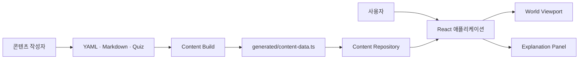
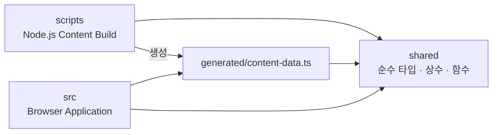
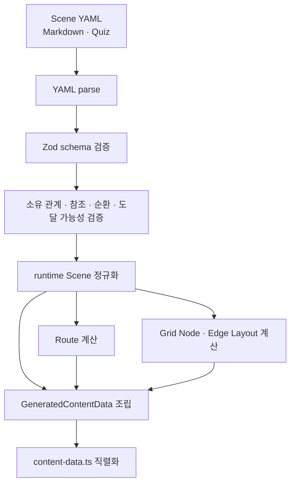
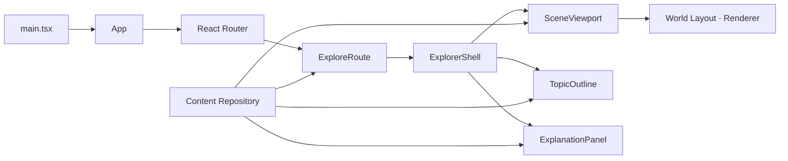

# CS Map 아키텍처

CS Map의 지속적인 시스템 구조와 책임 경계를 설명한다. 작성 콘텐츠가 빌드와 브라우저를 거쳐 화면에 표시되는 과정도 이 구조 안에서 다룬다. 제품 동작은 [제품 요구사항](./REQUIREMENTS.md), 용어는 [프로젝트 용어](./WORDS.md), 코드 작성 방식은 [코드 작성 가이드](./CODE_GUIDE.md)를 따른다.

## 시스템 개요

CS Map은 백엔드가 없는 정적 React 애플리케이션이다. 작성자는 YAML과 Markdown으로 지식 지도를 만들고, Content Build가 이를 검증된 TypeScript 데이터로 컴파일한다. 브라우저는 원본 작성 파일을 읽지 않고 생성 데이터만 조회한다.



실행 시점은 둘로 분리된다.

1. 빌드 시점: 작성 파일을 읽고 검증해 Route, Scene, 설명과 Layout을 생성한다.
2. 브라우저 실행 시점: 생성 데이터를 조회해 URL, 지도, Camera와 설명 상태를 조립한다.

## 기술 구성

- 애플리케이션: TypeScript, React, Vite, React Router
- 화면: Tailwind CSS, shadcn/ui, SVG Edge와 HTML Topic
- 콘텐츠 작성: YAML, Markdown
- 콘텐츠 검증: Zod
- Layout 생성: 5×5 Grid와 `elkjs-libavoid` 직교 Edge routing
- 배포: SPA fallback을 지원하는 정적 호스팅

## 모듈 구조

클래스보다 모듈과 React 컴포넌트가 주요 책임 단위다.

```text
frontend/
├── content/                 작성자가 관리하는 YAML·Markdown·Quiz
├── scripts/                 Node.js에서 실행되는 Content Build
│   └── content-build/       Schema, graph 검증과 생성 데이터 조립
├── shared/                  build와 browser가 공유하는 순수 계약
│   ├── content/             runtime 콘텐츠와 generated data 타입
│   └── layout/              Layout 타입과 geometry 상수
├── src/                     브라우저 애플리케이션
│   ├── app/                 Route와 애플리케이션 진입점
│   ├── content/             generated data adapter와 Repository API
│   ├── features/explorer/   World, Camera, Scene과 목차
│   └── features/explanation/ Markdown, Topic 설명과 Quiz
└── tests/                   build, Repository와 Layout 회귀 테스트
```

### 의존 방향



다음 경계를 지킨다.

- `scripts`와 `src`는 서로 import하지 않는다.
- `shared`는 `scripts`나 `src`에 의존하지 않는다.
- YAML 파싱, Zod Schema, 작성 문서 타입과 정규화는 `scripts/content-build`에만 둔다.
- 브라우저는 `content` 작성 디렉터리와 파일 경로를 알지 않는다.
- UI는 generated data를 직접 탐색하지 않고 Content Repository를 사용한다.
- 생성 파일은 사람이 직접 수정하지 않는다.

## 콘텐츠 모델

- `Scenario`: 전체 탐색의 `rootSceneId`를 지정한다.
- `Scene`: 제목, 요약, Area, Node, Edge와 선택적 Quiz를 가진 지도 단위다.
- `Node`: Scene에 배치되는 Topic 표현이다.
- `Child Scene`: Node의 `childSceneId`로 소유 관계를 만든다.
- `navigateToSceneId`: 포함 관계 없이 다른 Scene으로 이동한다.
- `description`, `contentRef`: 말단 Topic의 인라인 또는 Markdown 설명이다.

작성 데이터에는 URL과 화면 좌표를 저장하지 않는다. Parent 관계와 URL은 Scene 참조에서, Node 좌표와 Edge 경로는 Grid 작성값에서 빌드 시 계산한다.

## Content Build

`npm run content:build`는 [build-content-index.ts](../frontend/scripts/build-content-index.ts)를 실행한다. `npm run dev`와 `npm run build`도 애플리케이션 시작 전에 같은 과정을 실행한다.



### 빌드 책임

- `scripts/content-build/schemas.ts`: 작성 데이터 형식, 기본값과 필드 간 제약 검증
- `scripts/content-build/scene-graph.ts`: Child 소유권, 파생 metadata와 Root 도달 가능성 계산
- `scripts/content-build/relationship-validation.ts`: Scene 참조와 순환 검증
- `scripts/elk-scene-layout.ts`: Grid Node box와 직교 Edge 경로 계산
- `scripts/content-build/source-content.ts`: 작성 파일 탐색·검증과 Scene 준비
- `scripts/content-build/generated-content.ts`: Route 계산과 생성 TypeScript 직렬화
- `scripts/content-build/generated-file.ts`: 생성물 byte 검증·동기화와 이전 파일 정리
- `scripts/build-content-index.ts`: 검증·Layout·data 조립 단계 조율과 오류 집계

`content:validate`는 `--check` 모드로 같은 결과를 다시 계산한다. 생성 파일이 없거나 오래됐거나 이전 generated 파일이 남아 있으면 파일을 수정하지 않고 실패한다.

## 생성 데이터 계약

Content Build는 `src/content/generated/content-data.ts` 하나를 생성한다.

```ts
type GeneratedContentData = {
  rootSceneId: ContentId
  routes: readonly RouteIndexEntry[]
  scenes: Readonly<Record<ContentId, GeneratedSceneContent>>
  layouts: Readonly<Record<ContentId, SerializedSceneLayout>>
}
```

각 Scene record에는 완성된 `Scene`, Scene Markdown, Topic 설명과 선택적 Quiz가 포함된다. Root에서 도달할 수 없는 Scene은 Route, Scene과 Layout record에 생성하지 않는다.

공용 타입은 `shared/content`와 `shared/layout`이 소유한다. 생성 파일은 이 계약을 구현할 뿐 별도 비즈니스 로직을 갖지 않는다.

## 브라우저 실행 구조



### Content Repository

`src/content/content-repository.ts`는 생성 데이터를 기존 비동기 API로 노출하는 정적 adapter다.

- Root Scene과 Route 목록 조회
- URL에 대응하는 Route 조회
- Scene 지도와 Markdown 조회
- Topic 설명 조회
- unknown ID에 대한 일관된 오류 반환
- 기존 호출부 호환을 위한 완료된 Promise와 no-op prefetch 제공

브라우저에는 raw YAML/Markdown loader, Zod, 동적 content module과 요청 cache가 없다. 모든 콘텐츠가 애플리케이션 초기 JavaScript에 포함되므로 Repository의 비동기 형태는 I/O가 아니라 UI 계약 호환을 위한 것이다.

## Explorer 실행 흐름

### Scene URL 진입


### Topic 선택

- Child Scene Node: Route Index에서 대상 URL을 찾아 이동하고 Camera를 대상 Scene으로 이동한다.
- 다른 Scene 이동 Node: 포함 관계를 만들지 않고 지정한 Scene Route로 이동한다.
- 말단 Topic: URL과 Camera를 유지하고 Explanation Panel에서 설명을 연다.
- 목차 선택: Scene ID를 Route로 바꿔 같은 탐색 경로로 이동한다.

### 설명 표시

Explanation Panel은 현재 `sceneId`와 선택한 Topic을 기준으로 Repository를 호출한다.

- Scene 설명: Scene Markdown을 표시한다.
- Topic 설명: 생성된 Topic 설명을 표시하고 없으면 안내 상태를 표시한다.
- Quiz: `Scene.selfCheckQuiz`를 질문과 답변으로 표시한다.

## Layout과 렌더링

Layout은 두 단계로 나뉜다.

1. Build Layout: 5×5 Grid 작성값을 Node box와 Edge point로 계산해 generated data에 저장한다.
2. World Layout: 브라우저가 Parent Node 안에 Child Scene을 축소 배치해 하나의 World 좌표계로 합친다.

`scene-layout.ts`는 직렬화된 generated Layout을 `Map` 구조로 바꾸고 Scene별로 재사용한다. `SceneViewport`는 Camera와 전환을 관리하고, `WorldRenderer`는 현재 Camera에 보이는 Scene만 화면 좌표로 투영한다.

## 상태 소유권

| 상태 | 소유 모듈 | 역할 |
| --- | --- | --- |
| URL과 현재 Scene | React Router, `ExploreRoute` | URL을 Scene ID로 해석 |
| Panel 조립과 탐색 잠금 | `ExplorerShell` | 지도·설명·목차 연결과 Scene 이동 조율 |
| Camera와 애니메이션 | `SceneViewport` | 확대, 이동, Viewport 크기와 포커스 관리 |
| Scene 복귀 상태 | `exploration-memory.ts` | Camera, Panel, 선택 Topic과 스크롤 snapshot 보관 |
| World 좌표 | `world-layout.ts` | Parent·Child Scene의 재귀 배치 |
| 목차 검색과 펼침 | `TopicOutline` | Route 목록을 트리로 표현 |
| 설명 load와 탭 | `ExplanationPanel` | Scene·Topic·Quiz 표시 |

상태를 다른 모듈에 중복 저장하지 않는다. 화면 전환 중 유지해야 하는 값은 `ExplorerShell`과 탐색 snapshot이 소유하고, 계산 가능한 값은 Route와 generated data에서 파생한다.

## 오류와 신뢰 경계

- 작성 데이터 오류는 Content Build에서 모아 사람이 수정 가능한 파일 경로와 함께 보고한다.
- 잘못된 참조, 중복 소유, 순환과 도달 불가능 Scene은 브라우저 실행 전에 처리한다.
- 생성 Layout 누락과 unknown Route·Scene·Topic은 브라우저에서 명확한 오류가 된다.
- Markdown은 React Markdown을 통해 허용된 요소로 렌더링하며 임의 HTML과 JavaScript를 실행하지 않는다.
- 생성 데이터와 작성 파일의 동기화는 `content:validate`가 확인한다.

## 현재 결정과 예외

현재는 구조 단순화를 위해 모든 runtime 콘텐츠를 단일 `content-data.ts`에 생성하고 초기 JavaScript에 포함한다. 이는 [제품 요구사항](./REQUIREMENTS.md)의 “첫 화면에서 모든 Scene과 설명을 한꺼번에 불러오지 않는다”는 성능 목표와 다르며, 측정 결과를 확인한 사용자가 현재 규모에서는 허용한 예외다.

전환 측정값은 다음과 같다.

- 초기 JavaScript: 881,315 → 1,194,547 bytes, 35.54% 증가
- 전체 JavaScript 합계: 1,396,098 → 1,194,547 bytes, 14.44% 감소
- 생성 `content-data.ts`: 665,681 bytes

실제 초기 로딩 병목이 확인되면 Scene별 generated module, 동적 import, module Promise cache와 인접 Scene prefetch를 다시 검토한다. 측정 없이 이 복잡성을 미리 추가하지 않는다.

## 변경 가이드

- 콘텐츠 형식 변경: build-only Schema, normalize, generated contract와 Repository 소비를 함께 확인한다.
- Scene 관계 변경: scene graph, Route 생성과 World Layout 영향을 확인한다.
- Grid나 Node 크기 변경: shared metrics와 build Layout 결과를 확인한다.
- 생성 데이터 필드 변경: shared generated contract, renderer와 Repository test를 함께 변경한다.
- 탐색 동작 변경: Router, ExplorerShell, SceneViewport와 snapshot 책임을 순서대로 확인한다.
- 설명 UI 변경: Repository 결과 계약과 ExplanationPanel 상태를 확인한다.

## 검증

`frontend` 디렉터리에서 다음 검증을 실행한다.

```sh
npm run content:build
npm run content:validate
npm run typecheck
npm run test
npm run lint
npm run build
```

자동 검증은 콘텐츠 신뢰 경계, 생성 결과 동기화, module 의존 방향과 TypeScript 계약을 확인한다. 실제 Camera 이동, URL history, Panel scroll과 접근성 동작은 브라우저에서 별도로 확인한다.

## 구현 기준

- Content Build: [build-content-index.ts](../frontend/scripts/build-content-index.ts)
- Build Schema: [schemas.ts](../frontend/scripts/content-build/schemas.ts)
- 생성 계약: [generated-contract.ts](../frontend/shared/content/generated-contract.ts)
- Content Repository: [content-repository.ts](../frontend/src/content/content-repository.ts)
- Scene Layout: [elk-scene-layout.ts](../frontend/scripts/elk-scene-layout.ts), [scene-layout.ts](../frontend/src/features/explorer/layout/scene-layout.ts)
- World 렌더링: [world-layout.ts](../frontend/src/features/explorer/layout/world-layout.ts), [WorldRenderer.tsx](../frontend/src/features/explorer/components/WorldRenderer.tsx)
- 탐색 조립: [ExplorerShell.tsx](../frontend/src/features/explorer/ExplorerShell.tsx), [SceneViewport.tsx](../frontend/src/features/explorer/SceneViewport.tsx)
- 설명 UI: [ExplanationPanel.tsx](../frontend/src/features/explanation/ExplanationPanel.tsx)

구조가 바뀌면 이 문서의 모듈 책임, 의존 방향, 데이터 흐름과 알려진 예외를 함께 갱신한다.
