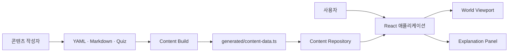
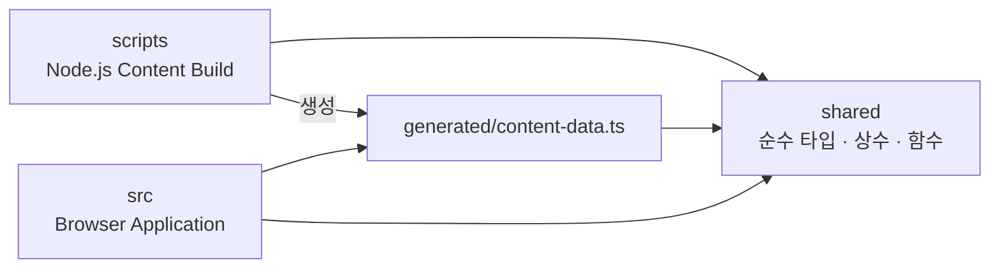
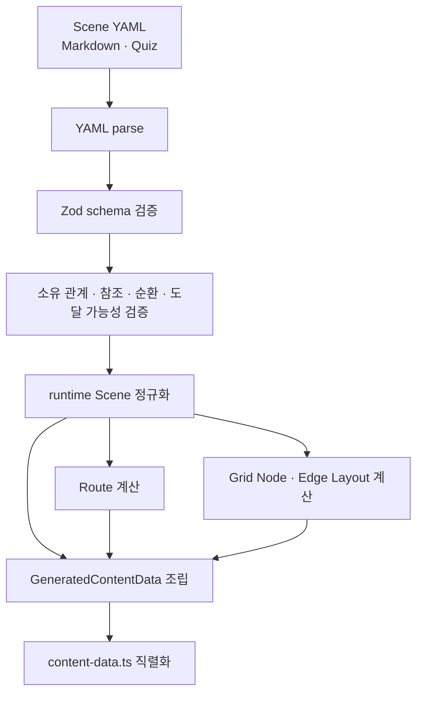
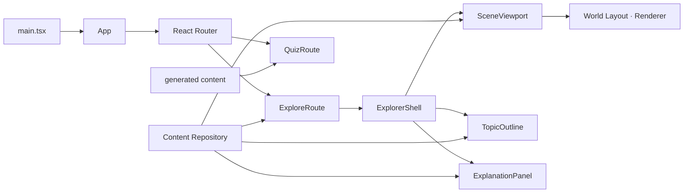
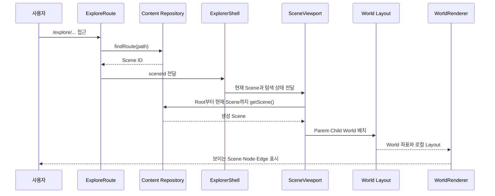

# CS Map 아키텍처

CS Map의 지속적인 시스템 구조와 책임 경계를 설명한다. 작성 콘텐츠가 빌드와 브라우저를 거쳐 화면에 표시되는 과정도 이 구조 안에서 다룬다. 제품 동작은 [제품 요구사항](./REQUIREMENTS.md), 용어는 [프로젝트 용어](./WORDS.md), 코드 작성 방식은 [코드 작성 가이드](./CODE_GUIDE.md)를 따른다.

## 시스템 개요

CS Map은 백엔드가 없는 정적 React 애플리케이션이다. 작성자는 YAML과 Markdown으로 지식 지도를 만들고, Content Build가 이를 검증된 TypeScript 데이터로 컴파일한다. 브라우저는 원본 작성 파일을 읽지 않고 생성 데이터만 조회한다.



실행 시점은 둘로 분리된다.

1. 빌드 시점: 작성 파일을 읽고 검증해 Route, Scene, 설명과 Layout을 생성한다.
2. 브라우저 실행 시점: 생성 데이터를 조회해 URL, 지도, Camera와 설명 상태를 조립한다.

## 기술 구성

- 애플리케이션: TypeScript, React, Vite, React Router
- 화면: Tailwind CSS, shadcn/ui, SVG Edge와 HTML Topic
- 콘텐츠 작성: YAML, Markdown
- 콘텐츠 검증: Zod
- Layout 생성: 5×5 Grid와 `elkjs-libavoid` 직교 Edge routing
- 배포: SPA fallback을 지원하는 정적 호스팅

## 모듈 구조

클래스보다 모듈과 React 컴포넌트가 주요 책임 단위다.

```text
frontend/
├── content/                 작성자가 관리하는 YAML·Markdown·Quiz
├── scripts/                 Node.js에서 실행되는 Content Build
│   └── content-build/       Schema, graph 검증과 생성 데이터 조립
├── shared/                  build와 browser가 공유하는 순수 계약
│   ├── content/             runtime 콘텐츠와 generated data 타입
│   └── layout/              Layout 타입과 geometry 상수
├── src/                     브라우저 애플리케이션
│   ├── app/                 Route와 애플리케이션 진입점
│   ├── content/             generated data adapter와 Repository API
│   ├── features/explorer/   World, Camera, Scene과 목차
│   ├── features/explanation/ Markdown, Topic 설명과 Scene별 Quiz
│   ├── features/home/        홈페이지 소개와 Quiz Preview
│   └── features/quiz/        독립 Quiz Bank, 범위 계산과 세션 화면
└── tests/                   build, Repository와 Layout 회귀 테스트
```

### 의존 방향



다음 경계를 지킨다.

- `scripts`와 `src`는 서로 import하지 않는다.
- `shared`는 `scripts`나 `src`에 의존하지 않는다.
- YAML 파싱, Zod Schema, 작성 문서 타입과 정규화는 `scripts/content-build`에만 둔다.
- 브라우저는 `content` 작성 디렉터리와 파일 경로를 알지 않는다.
- URL·Scene·Topic처럼 검증이 필요한 조회는 Content Repository를 사용한다. Root Scene ID와 Route 목록처럼 생성 단계에서 보장된 index는 generated data에서 직접 읽는다.
- 생성 파일은 사람이 직접 수정하지 않는다.

## 콘텐츠 모델

- `Scene`: 제목, 요약, 선택적 검색 키워드, Area, Node, Edge, 선택적 Light Flow와 Quiz를 가진 지도 단위다.
- `Scene Area`: 여러 Node를 시각적으로 묶는다. 작성 시 선택적인 `contentRef`로 Area 설명을 연결할 수 있지만 runtime에는 파일 경로 대신 설명 제공 여부만 남긴다.
- `Node`: Scene에 배치되는 Topic 표현이다.
- `Child Scene`: Node의 `childSceneId`로 소유 관계를 만든다.
- `navigateToSceneId`: 포함 관계 없이 다른 Scene으로 이동한다.
- `description`, `contentRef`: 말단 Topic의 인라인 또는 Markdown 설명이다. Scene Area는 Markdown 설명을 연결할 때만 선택적인 `contentRef`를 사용한다.
- `Light Flow`: Scene에 이미 존재하는 Edge를 순서 있는 stage로 묶은 요청 시점의 흐름 연출이다. 한 stage의 Edge는 동시에 재생되며 분기와 합류를 별도 그래프 탐색 없이 표현한다.
- `Edge ID`: 같은 Node 쌍의 Edge를 Light Flow에서 구분할 때 작성자가 선택적으로 부여하는 Scene 내부 ID다. Node ID와 다른 Edge ID 모두와 중복될 수 없으며, 명시하지 않은 Edge는 기존 작성 순서 기반 runtime ID를 유지한다.

작성 데이터에는 URL과 화면 좌표를 저장하지 않는다. Parent 관계와 URL은 Scene 참조에서, Node 좌표와 Edge 경로는 Grid 작성값에서 빌드 시 계산한다.

Scene ID는 `scene.yaml`에 작성하지 않는다. `content/scenes` 아래에서 `scene.yaml` 부모까지의 상대 경로 세그먼트를 `-`로 연결해 파생한다. 예를 들어 `content/scenes/server/spring/scene.yaml`은 `server-spring`이다. 각 경로 세그먼트는 소문자 kebab-case여야 하며 서로 다른 경로가 같은 파생 ID를 만들 수 없다. 고정 Root 파일 `content/scenes/scene.yaml`만 제품의 시작점을 나타내는 `enter-google` 상수를 ID로 사용한다.

## Content Build

`npm run content:build`는 [build-content-index.ts](../frontend/scripts/build-content-index.ts)를 실행한다. `npm run dev`와 `npm run build`도 애플리케이션 시작 전에 같은 과정을 실행한다.



### 빌드 책임

- `scripts/content-build/schemas.ts`: 작성 데이터 형식, 기본값과 필드 간 제약 검증
- 설명이 연결된 Area ID는 bare Fragment에서 Node와 구분할 수 있도록 같은 Scene의 Node ID와 충돌하면 `areas.<id>.contentRef` 위치에서 거부한다. 설명이 없는 Area와 Node의 기존 동일 ID는 허용한다.
- Light Flow 검증은 문자열 Edge ID 또는 `[from, to]`가 현재 Scene의 Edge 하나를 정확히 가리키는지와 Edge ID 충돌, stage 내 중복, 복수 Flow label 제약을 빌드 시점에 확인한다.
- `scripts/content-build/scene-graph.ts`: Child 소유권, 파생 metadata와 Root 도달 가능성 계산
- `scripts/content-build/relationship-validation.ts`: Scene 참조와 순환 검증
- `scripts/elk-scene-layout.ts`: Grid Node box와 직교 Edge 경로 계산
- `scripts/content-build/source-content.ts`: 작성 파일 탐색, 상대 폴더 경로 기반 Scene ID 검증·주입과 Scene 준비
- `scripts/content-build/generated-content.ts`: Route 계산과 생성 TypeScript 직렬화
- `scripts/content-build/generated-file.ts`: 생성물 byte 검증·동기화와 이전 파일 정리
- `scripts/build-content-index.ts`: 검증·Layout·data 조립 단계 조율과 오류 집계

`content:validate`는 `--check` 모드로 같은 결과를 다시 계산한다. 생성 파일이 없거나 오래됐거나 이전 generated 파일이 남아 있으면 파일을 수정하지 않고 실패한다.

## 생성 데이터 계약

Content Build는 `src/content/generated/content-data.ts` 하나를 생성한다.

```ts
type GeneratedContentData = {
  rootSceneId: ContentId
  routes: readonly RouteIndexEntry[]
  scenes: Readonly<Record<ContentId, GeneratedSceneContent>>
  layouts: Readonly<Record<ContentId, SerializedSceneLayout>>
}
```

각 Scene record에는 검색에 사용하는 요약·키워드를 포함한 완성된 `Scene`, Scene Markdown, Topic 설명, Topic과 분리된 Area 설명 record와 선택적 Quiz가 포함된다. Area의 작성용 `contentRef`는 Content Build가 같은 Scene 디렉터리의 Markdown과 로컬 이미지를 검증·변환한 뒤 제거하며, runtime `SceneArea`에는 설명 제공 여부만 남긴다. Root에서 도달할 수 없는 Scene은 Route, Scene과 Layout record에 생성하지 않는다.

작성된 Light Flow의 문자열 ID와 Edge 쌍은 normalize 단계에서 runtime Edge ID로 바뀌어 `Scene.lightFlows`에 저장된다. 명시적 Edge ID는 그대로 사용하고, ID가 없는 Edge는 기존 순서 기반 ID를 사용한다. 브라우저는 원본 참조 방식을 다시 해석하지 않고 생성된 ID로 기존 Edge Layout을 재사용한다.

공용 타입은 `shared/content`와 `shared/layout`이 소유한다. 생성 파일은 이 계약을 구현할 뿐 별도 비즈니스 로직을 갖지 않는다.

## 브라우저 실행 구조



### Content Repository

`src/content/content-repository.ts`는 생성 데이터에서 검증이 필요한 조회만 제공하는 정적 adapter다.

- URL에 대응하는 Route 조회
- Scene과 Markdown 조회
- Topic 설명 조회
- 실제 Scene에 존재하는 Area의 설명 조회
- Fragment ID가 현재 Scene의 leaf Topic 또는 설명 가능한 Area인지 판별
- unknown ID에 대한 일관된 오류 반환

Root Scene ID와 Route 목록은 generated data가 보장하는 index이므로 별도 Repository 메서드로 다시 감싸지 않는다. 브라우저에는 raw YAML/Markdown loader, Zod, 동적 content module과 요청 cache가 없으며 모든 콘텐츠가 애플리케이션 초기 JavaScript에 포함된다.

### 독립 Quiz Route

`/quiz`는 World Viewport와 Explanation Panel 바깥에서 동작하는 별도 Route다. `features/quiz/quiz-bank.ts`는 generated Route와 Scene의 기존 `selfCheckQuiz`를 조합해 문제 ID, 질문·답변과 출처 Scene 제목·경로가 포함된 Quiz Bank를 만든다. 콘텐츠 원본, Schema와 생성 계약은 변경하지 않는다.

범위는 generated Route의 `parentId` 관계로 계산한다. 전체 범위는 Quiz Bank의 모든 문제를, Scene 가지 범위는 선택한 Scene과 모든 자손 Scene의 문제를 포함한다. 퀴즈가 하나도 없는 가지는 선택 목록에서 제외한다.

`QuizPage`는 범위 선택, 고정된 셔플 결과, 현재 문제, 정답 공개 여부와 다시 볼 문제 ID를 컴포넌트 메모리에서만 관리한다. 마지막 문제를 평가하면 같은 상태에서 결과를 만들며 URL query, 브라우저 저장소와 서버에는 기록하지 않는다. 출처 링크는 Quiz Bank에 결합된 generated Route 경로를 사용해 Explorer로 이동한다.

`QuizPreview`는 상위 Route에서 퀴즈 데이터를 전달받지 않고 generated content와 같은 Quiz Bank 조합 함수를 직접 사용한다. 안정된 Quiz Bank 순서의 첫 문제만 홈페이지 대표 문제로 표시하고 정답 공개 여부는 컴포넌트 내부 상태로 관리한다. Quiz Bank가 비어 있으면 영역을 렌더링하지 않으며 CTA는 `/quiz` Route로 이동한다.

`QuizMarkdown`은 `SelfCheckQuestion`의 기존 `question`, `answer` 문자열을 runtime에서 React Markdown과 GFM으로 표시한다. Scene `QuizPanel`, `QuizPage`와 `QuizPreview`가 같은 컴포넌트를 사용하며 Schema와 generated content 계약은 바꾸지 않는다. 문제 번호나 `대표 문제` heading은 화면이 별도로 만들고 Markdown question은 heading 밖의 body로 렌더링한다. Quiz allowlist는 문단, blockquote, 목록, 강조, code와 줄바꿈으로 제한되며, heading, link, image, table, task input과 Raw HTML까지 지원하는 Explanation `MarkdownContent`보다 의도적으로 좁다.

## Explorer 실행 흐름

### Scene URL 진입



### Topic 선택

- Child Scene Node: Route Index에서 대상 URL을 찾아 이동하고 Camera를 대상 Scene으로 이동한다.
- 다른 Scene 이동 Node: 포함 관계를 만들지 않고 지정한 Scene Route로 이동한다.
- focused Scene의 말단 Topic: Camera와 Scene path를 유지하고 Topic ID를 bare Fragment로 추가해 Explanation Panel에서 설명을 연다.
- contextual Scene의 말단 Topic: owner Scene의 canonical Route와 Topic ID Fragment로 이동한다.
- 목차 선택: Scene ID를 Route로 바꿔 같은 탐색 경로로 이동한다.

Child Scene과 다른 Scene 이동 URL에는 현재 Fragment를 전달하지 않는다.

### Scene Area 선택

- 설명이 있는 focused Scene Area의 색칠된 사각형과 Label을 선택할 수 있다.
- Area 선택은 Camera와 현재 Scene path를 유지하고 Area ID를 bare Fragment로 추가해 Explanation Panel을 연다.
- Area는 Edge와 Node보다 먼저 렌더링하며, 위에 놓인 내부 Node가 pointer event를 우선 받아 기존 Topic 선택을 유지한다.
- 설명이 없는 Area의 Label은 기존 SVG Text로 렌더링하며 선택 상태를 만들지 않는다.

### 설명 표시

`explanation-url.ts`는 `location.hash`를 안전하게 bare ID로 읽고, owner Scene path와 ID로 canonical 선택 URL을 만들거나 hash를 제거한다. Content Repository는 현재 `sceneId`와 ID를 조합해 선택 가능한 leaf Topic 또는 설명 Area인지 검증한다. `ExplorerShell`은 두 결과에서 `ExplanationSelection`을 파생하며 별도 selection state를 보관하지 않는다.

Topic·Area 선택과 선택 해제는 history entry를 추가한다. valid Fragment 직접 접근과 뒤로 가기·앞으로 가기는 선택 스타일과 설명을 복원하고 Panel을 연다. malformed·unknown Fragment와 navigation Node ID는 선택 없음으로 처리하고 현재 Scene의 base URL로 replace한다.

- Scene 설명: Scene Markdown을 표시한다.
- Topic 설명: 생성된 Topic 설명을 표시하고 없으면 안내 상태를 표시한다.
- Area 설명: 실제 Scene에 존재하는 Area의 생성된 Markdown을 표시한다.
- Quiz: `Scene.selfCheckQuiz`를 질문과 답변으로 표시한다.

## Layout과 렌더링

Layout은 두 단계로 나뉜다.

1. Build Layout: 5×5 Grid 작성값을 Node box와 Edge point로 계산해 generated data에 저장한다.
2. World Layout: 브라우저가 Parent Node 안에 Child Scene을 축소 배치해 하나의 World 좌표계로 합친다.

`scene-layout.ts`는 직렬화된 generated Layout을 `Map` 구조로 바꾸고 Scene별로 재사용한다. `SceneViewport`는 Camera와 전환을 관리하고, `WorldRenderer`는 현재 Camera에 보이는 Scene만 화면 좌표로 투영한다.

`SceneNode`는 작성 Label의 실제 개행과 `\n` 표기만 줄 경계로 사용한다. 브라우저의 자동 줄바꿈은 허용하지 않으며, 각 줄의 예상 너비와 Node의 사용 가능한 높이를 기준으로 글씨 크기를 축소해 Label을 Node 내부에 맞춘다.

Light Flow 재생 상태는 `SceneViewport`가 소유한다. 렌더링에 필요한 활성 Edge·Node와 재생 식별자는 `LightFlowRenderProvider`가 `WorldRenderer` 하위에 Context로 전달하며, Camera와 Layout은 명시적인 Props로 유지한다. 상단 실행 버튼은 현재 focused Scene의 Flow만 시작한다. 첫 stage와 비연속 재시작은 출발 Node를 먼저 점등하고, 기존 polyline을 한 번 통과하는 Edge pulse 뒤에 도착 Node를 점등한다. 다음 stage의 출발 Node가 직전 도착 Node에서 이어지면 출발 점등을 반복하지 않고 다음 Edge pulse로 진행한다. 같은 stage의 Edge와 Node 집합은 동시에 표시하며, Scene이 바뀌면 진행 중인 재생을 취소한다.

## 상태 소유권

| 상태 | 소유 모듈 | 역할 |
| --- | --- | --- |
| URL, 현재 Scene과 설명 선택 | React Router, `ExploreRoute`, `ExplorerShell` | path를 Scene으로, hash를 검증된 Topic·Area 선택으로 해석 |
| Panel 조립과 탐색 잠금 | `ExplorerShell` | URL 선택과 지도·설명·목차 연결, Scene 이동 조율 |
| Camera와 애니메이션 | `SceneViewport` | 현재 Scene과 Viewport에 맞는 확대·이동 관리 |
| Light Flow 재생 | `SceneViewport` | 현재 Scene의 Flow 선택, stage 진행·완료와 Scene 이동 시 취소 관리 |
| World 좌표 | `world-layout.ts` | Parent·Child Scene의 재귀 배치 |
| 목차 검색과 펼침 | `Search` | Route 목록을 트리로 표현하고 Scene 제목·요약·Topic 이름·키워드를 검색하며 기본 목차와 결과에 필요한 Scene metadata를 표시 |
| 설명 load와 탭 | `ExplanationPanel` | Scene·Topic·Area·Quiz 표시 |
| 홈페이지 퀴즈 소개 | `QuizPreview` | Quiz Bank의 첫 문제 선택, 정답 공개와 독립 퀴즈 진입 |
| 독립 퀴즈 세션 | `QuizPage` | 범위 선택, 문제 순서, 정답 공개, 자기 평가와 결과를 메모리에만 유지 |

상태를 다른 모듈에 중복 저장하지 않는다. Topic·Area 선택은 URL hash가 source of truth다. Panel의 접힘·읽기 모드는 `useExplanationPanel`의 독립 UI state로 유지하며 URL에 직렬화하지 않는다. valid hash가 새로 열리거나 history에서 복원되면 Panel을 펼치지만, 이후 사용자가 접는 동작은 hash를 바꾸지 않는다. Camera처럼 Scene과 Viewport에서 계산 가능한 값은 저장하지 않고 다시 계산한다.

Search는 generated Route와 Scene을 결합한 `SearchEntry`를 검색 결과와 기본 목차에 함께 사용한다. `SearchItemContent`가 Scene 제목, 요약과 현재 위치 표시를 공통으로 담당하며 명시적인 옵션에 따라 검색 키워드와 Topic 이름 tag를 표시한다. `SearchResults`는 tag를 포함한 평탄한 결과 목록과 이동을, `SearchOutline`은 tag를 제외한 기본 목차의 트리 들여쓰기, 가지 펼침·접힘과 Link 이동을 각각 소유한다.

## 오류와 신뢰 경계

- 작성 데이터 오류는 Content Build에서 모아 사람이 수정 가능한 파일 경로와 함께 보고한다. 잘못된 Scene 경로 세그먼트와 중복 파생 ID도 이 단계에서 검사하며, 중복이면 관련된 두 파일 경로를 함께 표시한다.
- 잘못된 참조, 중복 소유, 순환과 도달 불가능 Scene은 브라우저 실행 전에 처리한다.
- 생성 Layout 누락과 unknown Route·Scene·Topic은 브라우저에서 명확한 오류가 된다.
- malformed·unknown 설명 Fragment는 실행 오류로 만들지 않고 선택 없음으로 처리해 base Scene URL로 정리한다.
- Markdown은 React Markdown을 통해 허용된 요소로 렌더링하며 임의 HTML과 JavaScript를 실행하지 않는다.
- 생성 데이터와 작성 파일의 동기화는 `content:validate`가 확인한다.

## 현재 결정과 예외

현재는 구조 단순화를 위해 모든 runtime 콘텐츠를 단일 `content-data.ts`에 생성하고 초기 JavaScript에 포함한다. 이는 [제품 요구사항](./REQUIREMENTS.md)의 “첫 화면에서 모든 Scene과 설명을 한꺼번에 불러오지 않는다”는 성능 목표와 다르며, 측정 결과를 확인한 사용자가 현재 규모에서는 허용한 예외다.

전환 측정값은 다음과 같다.

- 초기 JavaScript: 881,315 → 1,194,547 bytes, 35.54% 증가
- 전체 JavaScript 합계: 1,396,098 → 1,194,547 bytes, 14.44% 감소
- 생성 `content-data.ts`: 665,681 bytes

실제 초기 로딩 병목이 확인되면 Scene별 generated module, 동적 import, module Promise cache와 인접 Scene prefetch를 다시 검토한다. 측정 없이 이 복잡성을 미리 추가하지 않는다.

## 변경 가이드

- 콘텐츠 형식 변경: build-only Schema, normalize, generated contract와 Repository 소비를 함께 확인한다.
- Scene 관계 변경: scene graph, Route 생성과 World Layout 영향을 확인한다.
- Grid나 Node 크기 변경: shared metrics와 build Layout 결과를 확인한다.
- 생성 데이터 필드 변경: shared generated contract, renderer와 Repository test를 함께 변경한다.
- 탐색 동작 변경: Router, ExplorerShell, SceneViewport와 snapshot 책임을 순서대로 확인한다.
- 설명 UI 변경: Repository 결과 계약과 ExplanationPanel 상태를 확인한다.
- 독립 퀴즈 변경: generated Route·Scene 조합, 자손 범위 계산과 QuizPage의 비저장 세션 흐름을 함께 확인한다.

## 검증

`frontend` 디렉터리에서 다음 검증을 실행한다.

```sh
npm run content:build
npm run content:validate
npm run typecheck
npm run test
npm run lint
npm run build
```

자동 검증은 콘텐츠 신뢰 경계, 생성 결과 동기화, module 의존 방향과 TypeScript 계약을 확인한다. 실제 Camera 이동, URL history, Panel scroll과 접근성 동작은 브라우저에서 별도로 확인한다.

## 구현 기준

- Content Build: [build-content-index.ts](../frontend/scripts/build-content-index.ts)
- Build Schema: [schemas.ts](../frontend/scripts/content-build/schemas.ts)
- 생성 계약: [generated-contract.ts](../frontend/shared/content/generated-contract.ts)
- Content Repository: [content-repository.ts](../frontend/src/content/content-repository.ts)
- Scene Layout: [elk-scene-layout.ts](../frontend/scripts/elk-scene-layout.ts), [scene-layout.ts](../frontend/src/features/explorer/layout/scene-layout.ts)
- World 렌더링: [world-layout.ts](../frontend/src/features/explorer/layout/world-layout.ts), [WorldRenderer.tsx](../frontend/src/features/explorer/components/WorldRenderer.tsx)
- 탐색 조립: [ExplorerShell.tsx](../frontend/src/features/explorer/ExplorerShell.tsx), [SceneViewport.tsx](../frontend/src/features/explorer/SceneViewport.tsx)
- 설명 UI: [ExplanationPanel.tsx](../frontend/src/features/explanation/ExplanationPanel.tsx)

구조가 바뀌면 이 문서의 모듈 책임, 의존 방향, 데이터 흐름과 알려진 예외를 함께 갱신한다.
